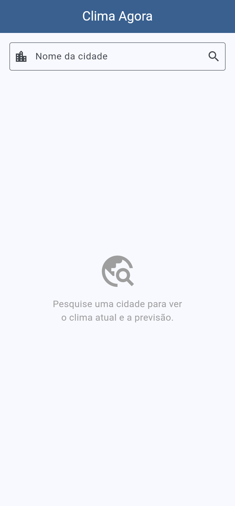
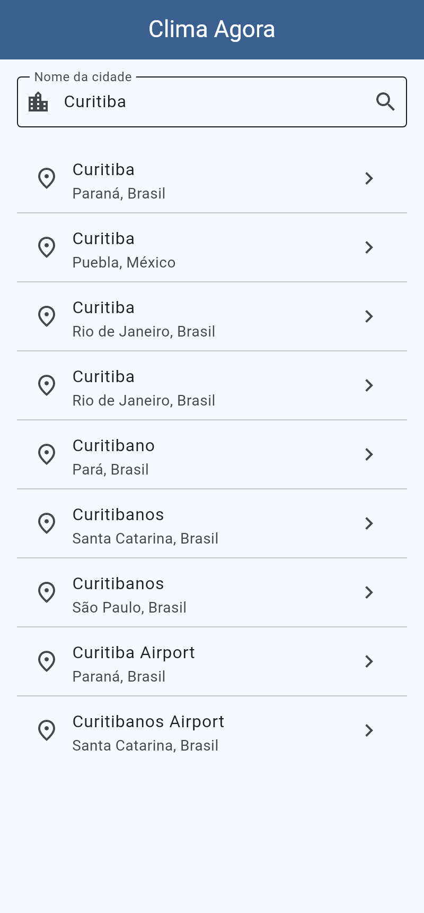
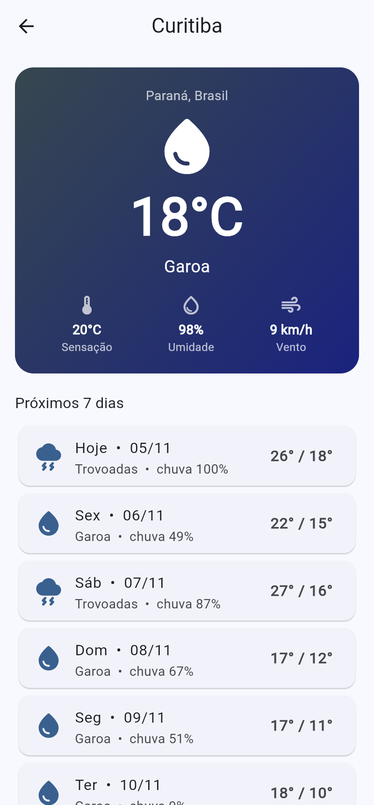
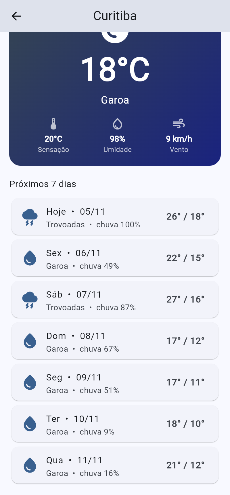
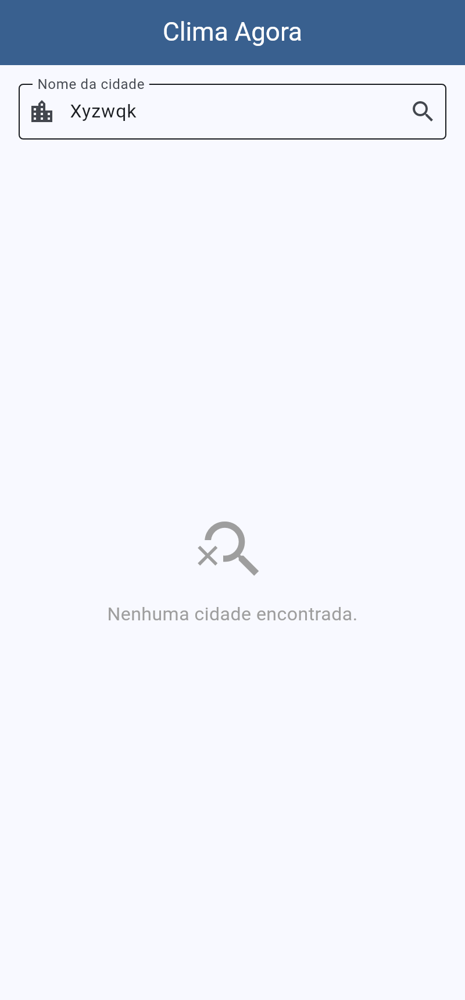
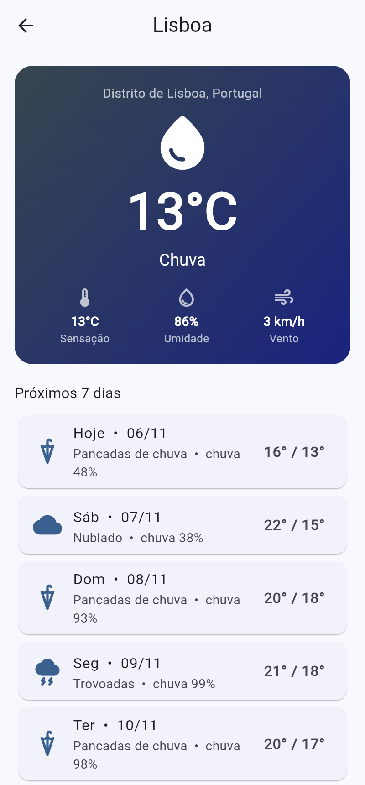

# Clima Agora — App Flutter consumindo API REST

Aplicativo Flutter que consulta o clima atual e a previsão de 7 dias de qualquer cidade do mundo.

## API utilizada

**Open-Meteo** — API meteorológica gratuita e aberta (não exige chave de acesso).

| Endpoint | Endereço | Uso no app |
|---|---|---|
| Geocoding API | `https://geocoding-api.open-meteo.com/v1/search` | Busca cidades pelo nome (latitude/longitude) |
| Forecast API | `https://api.open-meteo.com/v1/forecast` | Clima atual + previsão diária de 7 dias |

Site / documentação: https://open-meteo.com/en/docs

## Conceitos aplicados

- **Requisições HTTP** com o pacote [`http`](https://pub.dev/packages/http) (`GET` com query parameters, verificação de `statusCode`, timeout).
- **JSON**: `jsonDecode` + classes de modelo com construtor `fromJson` (`Cidade`, `Previsao`, `ClimaAtual`, `PrevisaoDia`).
- **Métodos assíncronos**: `Future`, `async`/`await`, `FutureBuilder` para estados de carregando / erro / sucesso, `RefreshIndicator` (puxar para atualizar).
- **Interface**: `ListView`, `Card`, `ListTile`, navegação com `Navigator.push`, tratamento de lista vazia e erro de rede.

## Estrutura

```
lib/
├── main.dart                     # MaterialApp e tema
├── models/
│   ├── cidade.dart               # modelo da Geocoding API
│   └── previsao.dart             # modelos da Forecast API
├── services/
│   └── clima_service.dart        # requisições HTTP
├── screens/
│   ├── busca_screen.dart         # busca de cidades
│   └── previsao_screen.dart      # clima atual + 7 dias
└── utils/
    └── wmo.dart                  # códigos WMO → texto e ícone
```

## Como executar

```bash
flutter pub get
flutter run          # emulador Android, iOS ou: flutter run -d chrome
flutter test
```

## Capturas de tela

| Início | Busca | Previsão |
|---|---|---|
|  |  |  |
|  |  |  |
